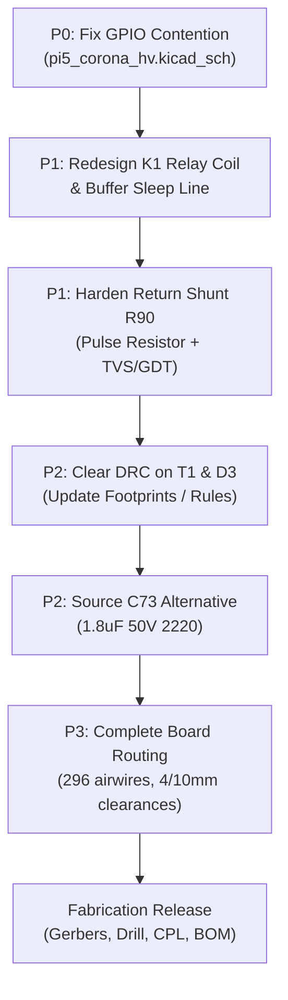

# Hardware Engineering Audit: Pi 5 Corona HAT Direct

**Project:** Raspberry Pi 5 Corona Discharge & Ionic Thrust High-Voltage Supply HAT  
**Directory:** `hardware/pi5_corona_hat_direct`  
**Active KiCad Project:** `pi5_corona_hv.kicad_pro`  
**Revision:** Revision H / Layout I-layout-4  
**KiCad Version:** 10.0.6  
**Audit Date:** 2026-10-03  
**Status:** 🟡 **DESIGN HOLD — NOT FABRICATION READY**

---

## 1. Executive Summary & Verdict

The `pi5_corona_hat_direct` project is a Raspberry Pi 5 HAT carrier integrating a programmable USB-C Power Delivery (PD) sink, an H-bridge primary inverter, a resonant step-up transformer, and a 6-stage Cockcroft-Walton multiplier designed to generate up to 15 kV DC for atmospheric corona discharge experiments.

This audit evaluates the schematic design, electrical safety, component ratings, mechanical alignment, PCB layout rules, and procurement feasibility.

### Verification Summary

| Check / Domain | Result | Key Metric / Observation |
|---|---|---|
| **Overall Fabrication Readiness** | 🔴 **NOT READY** | Layout is unrouted (296 airwires); 1 critical schematic short; 2 electrical holds |
| **Schematic ERC** | 🟢 **PASS** | 0 errors, 0 warnings under KiCad 10.0.6 ERC |
| **PCB DRC** | 🔴 **FAIL** | 11 violations (2 clearance violations, 1 footprint mismatch, 8 stub tracks) |
| **Board Routing** | 🔴 **2% COMPLETE** | Only 8 neck stubs placed; 296 unrouted connections |
| **USB-PD Capacitance Budget** | 🟢 **PASS** | 9.98 µF attachment (< 10 µF limit); 98.23 µF post-contract (< 100 µF limit) |
| **Mechanical Fit (Pi 5)** | 🟢 **PASS** | 0 substrate collisions across 2,689 solids of official Pi 5 STEP model |
| **High-Voltage Spacing** | 🟡 **CONDITIONAL** | 4.0 mm stage and 10.0 mm HV clearance rules defined; T1 secondary pads violate 4.0 mm rule |
| **Procurement Parity** | 🟡 **95% MATCHED** | 149/157 items catalog-assigned; T1 consignment required; K1 on hold; C73 zero stock |

---

## 2. System Architecture

```mermaid
flowchart LR
    subgraph Host["Host Interface & Control"]
        Pi["Raspberry Pi 5\n(40-pin GPIO Header J2)"]
        Sensors["BME280 (U5)\nTSL2591 Mini-Board (U8)\nADS1115 16-bit ADC (U6)"]
    end

    subgraph PowerPath["USB-PD & Power Staging"]
        USBC["USB-C 16-Pin (J3)\n5 V - 20 V PPS"] --> Polyfuse["1A PTC (F1)"]
        Polyfuse --> Sink["AP33772S PD Sink (U7)\n+ AO4262E Switch (Q1)"]
        Sink --> eFuse["TPS259470 eFuse (U9)\nBULK_EN (GPIO25)"]
        eFuse --> Relays["DPDT Interlock Relay (K1)\n+ Lid Switches (S3, S4)"]
    end

    subgraph DriveHV["Inverter & Resonant HV Multiplier"]
        Relays --> Driver["DRV8876 H-Bridge (U2)\nPWM0/1 (GPIO18/19)"]
        Driver --> Resonant["Resonant Cap C11 (120nF/630V)\n+ Coilcraft FL2015-4LD (T1)"]
        Resonant --> CW["6-Stage Cockcroft-Walton\n12x Sunmate 2CL75 (16kV)\n12x 6kV Caps + 300M Bleeders"]
        CW --> Ballast["100M Ballast Chain (R20-R29)"]
        Ballast --> HVOut["HV_OUT (J60)\n15 kV DC"]
    end

    HVOut -. Corona Load .- HVRet["HV_RETURN (J61)"]
    HVRet --> Shunt["10k Shunt (R90)\n+ Clamp (D4)"] --> Sensors
    CW -. 1G Divider (R30-R39) .-> Buffer["TLV9001 (U4)"] --> Sensors
    Host -- "I2C (0x48, 0x76, 0x29, 0x51)" --- PowerPath
    Host -- "PWM & Sleep" --- DriveHV
```



### Power Domains & Isolation
1. **Logic Domain (3.3 V):** Powered strictly from the Raspberry Pi 5 3.3 V rail via J2 Pin 1. The Pi 5 5.0 V pins (Pins 2 & 4) are unconnected. The HAT cannot back-power the Pi, nor can the Pi power the HV inverter.
2. **Intermediate Switched Rail (`VIN_PROTECTED`):** Sourced from USB-C PD (5 V to 20 V). Gated by eFuse U9 under Pi firmware control (`GPIO25`/`BULK_EN`) to adhere to USB-IF inrush and capacitance limits.
3. **High-Voltage Domain (`HV_RAW`, `HV_OUT`, `HV_RETURN`):** Isolated from logic GND. `HV_RETURN` connects to logic GND strictly through a low-side current sensing shunt (R90, 10 kΩ) and BAT54S protection clamp.

---

## 3. Critical Findings & Electrical Review Holds

### 3.1 [P0 - Critical] Hardwired Pi 5 GPIO Pin Short-Circuit (GPIO23 & GPIO24)
- **Location:** Root schematic `pi5_corona_hv.kicad_sch`, lines 5580–5615 and 6114–6195.
- **Root Cause:**
  - Sheet `01_power_mcu` exposes hierarchical output `INTERLOCK_OK` (connected to J2 Pin 16, Pi **GPIO23**).
  - Sheet `01_power_mcu` exposes hierarchical output `DRV_nSLEEP` (connected to J2 Pin 18, Pi **GPIO24**).
  - On the root sheet, the wire from sheet pin `INTERLOCK_OK` (at `xy 160.02 83.82`) is labeled **`DRV_nSLEEP`**.
  - The wire from sheet pin `DRV_nSLEEP` (at `xy 160.02 99.06`) is also labeled **`DRV_nSLEEP`**.
- **Impact:**
  - Pi 5 GPIO23 and GPIO24 are shorted directly together through net `/DRV_nSLEEP`.
  - If firmware configures GPIO23 as an input (reading interlock state) and GPIO24 as an output HIGH (3.3 V) or LOW (0 V), any conflicting drive state will cause **direct I/O buffer contention and severe SoC damage**.
- **Remediation:** Re-label the wire at `(160.02, 83.82)` on `pi5_corona_hv.kicad_sch` to `INTERLOCK_OK` and connect it to sheet `04_sense_safety` pin `INTERLOCK_OK`.

### 3.2 [P1 - High] Relay K1 Coil Voltage Mismatch & Sleep Contention
- **Location:** Sheet `04_sense_safety.kicad_sch`, component `K1` (`N4078-2C-DC12V-0.2W`).
- **Issues:**
  1. **Coil Overdrive / Dropout:** The 12 V nominal relay coil (720 Ω) is connected in series with microswitches S3 and S4 across `VIN_PROTECTED`. When USB-PD negotiates 20 V, the coil dissipation reaches $20^2 / 720 = 0.556\text{ W}$, a **278% overload** on a 0.2 W rated coil. Conversely, at 5 V attachment, the relay cannot pull in (nominal pull-in voltage is 9.0 V).
  2. **Sleep Line Contention:** Relay contact 2 connects `3V3` to `/DRV_nSLEEP` when energized. If the Pi drives GPIO24 LOW while K1 is closed, the Pi GPIO drives directly against the 3.3 V power rail.
- **Remediation:**
  - Power the relay coil from a regulated 12 V rail or redesign the interlock circuit using a logic-level gate or 3.3 V relay.
  - Route the Pi driver sleep control *through* the relay contact in series to the DRV8876 `nSLEEP` pin, rather than switching a raw power rail onto a microcontroller output net.

### 3.3 [P1 - High] HV Current Shunt Arc Vulnerability
- **Location:** Sheet `04_sense_safety.kicad_sch`, components `R90` (10 kΩ, 0603) and `D4` (`BAT54S`).
- **Issue:**
  - `HV_RETURN` connects to GND via R90 to provide current telemetry to ADS1115 AIN1.
  - During atmospheric breakdown, corona arcing, or direct output short-circuit, the Cockcroft-Walton ladder capacitance dumps pulse currents into `HV_RETURN`.
  - Standard 0603 chip resistors have a maximum pulse voltage rating of ~50–100 V and can flash over or fuse open. BAT54S has a maximum peak forward surge rating of only 200 mA.
  - If R90 fuses open during an arc, `HV_RETURN` floats to several kilovolts, destroying D4, the ADS1115 ADC, and injecting high voltage into the Raspberry Pi 3.3 V logic domain.
- **Remediation:**
  - Upgrade R90 to a pulse-withstanding resistor (e.g. MELF or 1206 high-energy pulse series).
  - Add a high-speed TVS diode (or miniature gas discharge tube, GDT) in parallel with R90 directly to GND to clamp transient arc spikes.

---

## 4. Subsystem Audits

### 4.1 USB-PD Staging & Capacitance Management
- **Attachment Compliance:**
  - Unswitched capacitors on `VBUS_RAW` and `VIN_PD`: C21 (4.7 µF), C73 (1.8 µF), C17 (1.0 µF), C18–C20 (1.2 µF), C71–C72 (0.102 µF).
  - Worst-case attachment capacitance including positive tolerances and 0.3 µF parasitic allowance: **9.982 µF** $\le 10.0\text{ µF}$ (Passes USB-IF $cSnkBulk$).
- **Post-Negotiation Compliance:**
  - Switched reservoir on `VIN_PROTECTED` and `HV_BRIDGE`: C22 (10 µF), C70 (22 µF), C10 (100 nF), C12 (10 µF), C60 (33 µF), C61 (100 nF), C62 (22 nF).
  - Total downstream switched capacitance: **98.227 µF** $\le 100.0\text{ µF}$ (Passes USB-PD Rev 3.2 without requiring complex surge certification).
- **Primary Protection:**
  - F1: `BSMD1206-100-30V` (1.0 A hold, 30 V PTC polyfuse).
  - Q1: `AO4262E` (60 V, 6.5 mΩ $R_{DS(on)}$, SO-8), driven by AP33772S gate output.
  - U9: `TPS259470LRPWR` eFuse sets 1.0 A current limit (R73 = 3.32 kΩ) and 22 V overvoltage lockout (R71/R72 = 976 kΩ / 56.2 kΩ).

### 4.2 Inverter Drive & Transformer
- **Driver:** TI `DRV8876PWPR` (U2), 4.5 V to 37 V operating range, 40 V absolute maximum.
- **Primary Snubber & Regeneration:**
  - Recirculation bridge: D52–D55 (`SS36`, 60 V / 3 A Schottky diodes in SMC package).
  - Snubber clamp: D50 (`VSSA310S-M3`, 100 V Schottky) isolates `HV_VM` from bridge regeneration; D51 (`SMBJ22A`, 22 V TVS) clamps transients to 35.5 V max.
  - RC Snubber: C63 (1 nF) and R64 (100 Ω) are properly marked **`DNP`** for bench tuning.
- **Transformer:** Coilcraft `FL2015-4LD` CCFL step-up transformer. Driven in full-bridge resonant topology via C11 (120 nF / 630 V metallized polypropylene film capacitor).

### 4.3 Multiplier & High-Voltage Ladder
- **Diodes (D10–D21):** Upgraded in Rev H to **Sunmate 2CL75** (`C424512`):
  - $V_{RRM} = 16\text{ kV}$, $I_{F(AV)} = 5\text{ mA}$, $I_{FSM} = 0.5\text{ A}$, $t_{rr} \le 100\text{ ns}$, $C_j = 1\text{ pF}$.
  - Placed on a 26 mm formed axial lead pitch with 0.9 mm plated drills.
  - *Note:* The 150 µA target output current does not reflect peak diode repetitive charging pulses. Pulse currents during resonance must be validated on bench test.
- **Bleeder Networks:**
  - 12 banks of $3\times 100\text{ M}\Omega$ series Bourns `CHV2512-JW-107ELF` resistors = 300 MΩ per capacitor bank (3.6 GΩ total).
  - Nominal capacitor operating voltage is 2.5 kV (worst-case static tolerance split ~2.14 kV, well within the 3 kV continuous rating of the CHV2512).
  - Multiplier discharge time constant: $\tau \approx 0.30\text{ s}$ ($\sim 1.8\text{ s}$ to discharge 6 kV below 50 V).
- **HV Divider:**
  - 10× 100 MΩ Bourns CHV2512 in series (1.0 GΩ) with 164 kΩ lower arm (R8+R9), buffered by TLV9001 opamp. Ratio is 6098.56:1.
  - Voltage coefficient (up to ±300 ppm/V) requires multi-point voltage calibration.
- **Ballast Resistors:**
  - R20–R29: 10× 10 MΩ series high-voltage metal glaze resistors (`MGR0W2J0106A10`, 100 MΩ total) damping output discharges into J60.

---

## 5. PCB Layout, Mechanical & DRC Audit

### 5.1 Physical Specifications & Dimensions
- **Layer Count:** 2 copper layers (`F.Cu`, `B.Cu`), 1.6 mm FR-4 finished thickness.
- **Main Carrier Outline:** $271.0 \times 150.0\text{ mm}$ ($x = 50$ to $321\text{ mm}$, $y = 50$ to $200\text{ mm}$).
- **Overall Envelope:** $306.0 \times 150.0\text{ mm}$ (including three $30\text{ mm}$ break-off mini-boards along the left edge).
- **Raspberry Pi 5 Alignment:**
  - Header J2 placed at `(54.23, 106.63)` mm, rotated 180°.
  - Mounting holes H1 `(55.5, 111.5)` and H2 `(55.5, 53.5)` align with the Pi 5 GPIO-side mounting holes (58.0 mm spacing).
  - The Pi 5 body hangs outboard to the left. Substrate clearance analysis verifies **zero intersections** with the carrier board across 2,689 solids of the Pi 5 STEP model at 12 mm standoff height.

### 5.2 Copper Pour & High-Voltage Keepout Rules
- **HV Keepout Zone:** A strict dual-layer copper keepout (`layers "F.Cu" "B.Cu"`) is enforced from `(122, 52)` to `(320, 199)` mm, completely forbidding copper pours under the transformer, multiplier, bleeders, ballast, and HV terminations.
- **GND Pour:** Confined exclusively to bottom layer `B.Cu` from `(52, 52)` to `(121, 198)` mm in the low-voltage control domain.

### 5.3 DRC Violations Analysis (11 Total)

```
[DRC Violation Summary]
├─ Clearance Violations (2)
│  ├─ T1 Pad 5 (/SEC_A) to T1 Pad 8 (/HV_RETURN): 3.20 mm actual vs 4.00 mm rule
│  └─ T1 Pad 8 (/HV_RETURN) to T1 Pad 5 (/SEC_A): 3.20 mm actual vs 4.00 mm rule
├─ Library Footprint Mismatch (1)
│  └─ D3 (BAT54S flyback): Footprint 'D_SOD-323' does not match library copy
└─ Dangling Track Stubs (8)
   └─ 8 stub tracks on break-off necks between carrier and mini-boards
```

1. **Transformer Clearance Violations:** T1 pin pitch is 5.0 mm with 1.8 mm diameter through-hole pads, resulting in $5.0 - 1.8 = 3.20\text{ mm}$ copper-to-copper spacing. The custom rule `HV_STAGE copper clearance` mandates 4.00 mm min clearance.
   - *Resolution:* Either slot `Edge.Cuts` between pins 5 and 8, or provide an explicit rule exemption for the package pins of T1 while maintaining creepage standards.
2. **Library Footprint Mismatch:** D3 footprint definition differs slightly from `ionic_thrust_hv.pretty`. Update from library to clear.
3. **Neck Stubs:** Break-off tabs between carrier and mini-boards contain incomplete routing stubs.

### 5.4 Routing Readiness
- **Status:** **UNROUTED**.
- Segments: 8 tracks (neck stubs only).
- Vias: 1 via.
- Unconnected Items: **296 airwires** remaining.
- The board cannot be fabricated until complete manual or automated routing is completed and verified against all 4.0 mm and 10.0 mm clearance rules.

---

## 6. Procurement & Sourcing Matrix

| Ref Des | MPN | Vendor / LCSC | Stock Status | SMT Assembly | Notes |
|---|---|---|---|---|---|
| **T1** | `FL2015-4LD` | Coilcraft | *Consignment* | Manual / Hand | **External Sourcing**: CCFL transformer, no JLCPCB match |
| **K1** | `N4078-2C-DC12V-0.2W` | C52195125 | In Stock (2) | manualWeld | **Electrical Hold**: 12 V coil on 5–20 V rail |
| **C73** | `C2220C185J5RAC7800` | C3900748 | **0 Stock** | Standard SMT | 1.8 µF / 50 V / 5% 2220; source alternative or pre-order |
| **D10–D21** | `2CL75` | C424512 | In Stock (1,006) | manualWeld | Sunmate 16 kV / 5 mA HV axial diode |
| **R30–R39, R140–R163** | `CHV2512-JW-107ELF` | C2089706 | In Stock | Standard SMT | Bourns 100 MΩ / 3 kV / 2512 resistor (46 pcs) |
| **U2** | `DRV8876PWPR` | C575551 | In Stock | Standard SMT | H-bridge motor driver, HTSSOP-16 |
| **U7** | `AP33772SDKZ-13-FA01` | C24374260 | In Stock | Standard SMT | USB-PD sink controller, QFN-24 |
| **U9** | `TPS259470LRPWR` | C3662793 | In Stock | Standard SMT | TI eFuse, VSON-10 |
| **U8** | `TSL25911FN` | C176812 | In Stock | Standard SMT | Ambient light sensor on break-off board |
| **C63, R64** | — | — | — | **DNP** | Optional primary RC snubber |
| **MP1** | Pi 5 STEP Model | — | — | **DNP** | Board-only 3D reference; excluded from BOM/CPL |
| **J60, J61** | Solder-Wire Pads | — | — | PCB Feature | HV solder pads; high-voltage silicone wire required |

---

## 7. Action Plan & Remediation Roadmap



### Remediation Checklist

1. [ ] **Correct GPIO Contention in Schematic (P0):**
   - In `pi5_corona_hv.kicad_sch`, change the label at `(165.1, 83.82)` from `DRV_nSLEEP` to `INTERLOCK_OK`.
   - Verify netlist export confirms J2 Pin 16 is on `/INTERLOCK_OK` and J2 Pin 18 is on `/DRV_nSLEEP`.
2. [ ] **Resolve Relay K1 Electrical Hold (P1):**
   - Provide a regulated 12 V rail for the coil, or substitute a solid-state interlock / 3.3 V logic relay.
   - Disconnect `3V3` from K1 pin 13 to avoid driving the microcontroller sleep pin high through a closed contact.
3. [ ] **Harden Low-Side Shunt (P1):**
   - Replace R90 (0603) with a pulse-rated MELF or 1206 resistor.
   - Add a TVS diode (or miniature GDT) across `HV_RETURN` and GND.
4. [ ] **Clear DRC Violations (P2):**
   - Update footprint `D_SOD-323` for D3 from library.
   - Adjust pad geometry or add a custom clearance exemption rule for T1 secondary pins 5 and 8.
   - Complete trace routing across the break-off neck tabs to eliminate the 8 dangling track violations.
5. [ ] **Procurement Substitution (P2):**
   - Select an in-stock JLCPCB alternative for C73 (1.8 µF / 50 V).
6. [ ] **Complete PCB Routing (P3):**
   - Route all 296 airwires maintaining 4.0 mm clearance between CW stages and 10.0 mm clearance around `HV_RAW` / `HV_OUT`.
